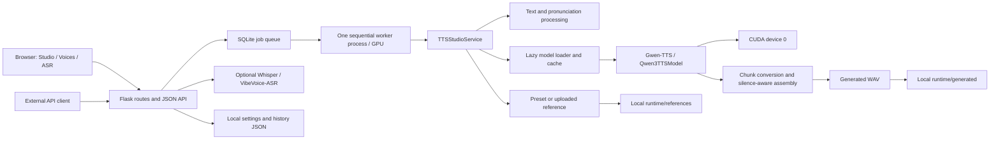
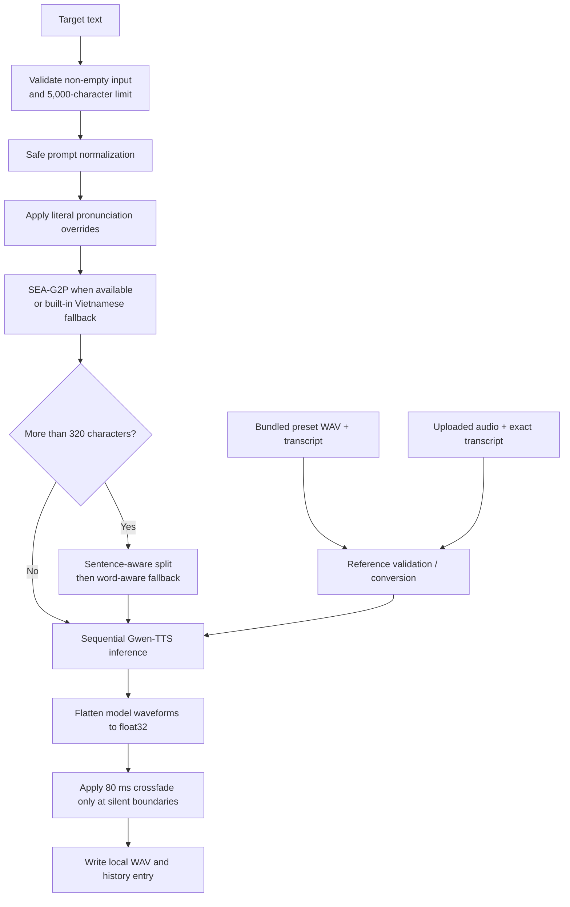

<p align="center">
  <a href="README.md">Tiếng Việt</a> · <strong>English</strong>
</p>

<div align="center">
  
  <h1>Vietnamese TextVoice Studio</h1>
  <p>Vietnamese speech synthesis studio built around Gwen-TTS, reference-audio conditioning, text normalization, long-form generation, and a local Flask web/API layer.</p>

  
  
  
  
  
  
</div>

> Use reference recordings only with the speaker's consent and with permission to synthesize the intended content.

## Overview

Vietnamese TextVoice Studio targets two related tasks:

```text
Vietnamese TTS
Target text + bundled preset reference → Gwen-TTS → WAV

Reference-conditioned synthesis (voice cloning)
Reference audio + exact reference transcript + target text → Gwen-TTS → WAV
Reference audio + target text → VieNeu v3 Turbo → WAV
```

The Studio lets each request use one engine: Gwen-TTS or VieNeu v3 Turbo. VieNeu clones from reference audio without a transcript; the worker loads it on the first job and keeps only one TTS model active at a time. VieNeu is optional: `python -m pip install -r yeu_cau_vieneu.txt`. The worker disables Hugging Face's shared-blob cache before loading VieNeu so ONNX Runtime can resolve the external weights. Try voice cloning in [the Google Colab notebook](thu_nghiem_vieneu_clone_giong_colab.ipynb).

“Voice cloning” in this repository means inference-time conditioning. The application does not train, fine-tune, or persist a new speaker model for each user. Gwen-TTS uses a matching reference transcript; VieNeu takes reference audio directly.

The project adds an application layer around model inference: Vietnamese-oriented text cleanup, optional `sea-g2p` normalization, pronunciation overrides, reference validation, chunked long-text inference, crossfaded audio assembly, preset management, background jobs, local history/settings, and optional ASR. The browser Studio supports Gwen-TTS presets and custom reference audio for both Gwen-TTS and VieNeu.

## Technical Highlights

- Two-stage Vietnamese text preparation with Unicode, formatting, punctuation, date, number, unit, and abbreviation handling.
- Exact, user-defined pronunciation substitutions applied before language normalization.
- Ten bundled reference voices with local WAV assets and matching transcripts.
- Reference-conditioned Gwen-TTS inference with direct-call and compatibility fallbacks.
- Up-to-320-character punctuation-aware chunks, reusable clone prompts, adaptive codec budgets, and silence-gated crossfades.
- Configurable main-talker and code-predictor generation parameters with server-side range clamping.
- SQLite queue with backpressure, polling, bounded lease retries, and one sequential worker process per GPU.
- Optional Whisper reference transcription and VibeVoice-ASR general transcription.

## System Architecture



### Layers

- **UI:** server-rendered Jinja templates, vanilla JavaScript, and responsive CSS for Studio, Voices, and optional ASR pages.
- **Application:** Flask validates multipart requests, serves generated files, persists settings/history, and exposes sync/async APIs.
- **Service:** `TTSStudioService` owns preprocessing, model resolution/loading, inference, reference handling, audio joining, and ASR.
- **Runtime:** uploaded references, converted reference WAVs, generated outputs, JSON state, in-memory jobs, and external Hugging Face caches.

## End-to-End TTS Pipeline



Request flow:

1. Flask resolves either a bundled `preset_voice_id` or an uploaded `reference_audio`.
2. `TTSStudioService.synthesize()` validates target text, reference existence, CUDA/model readiness, and the required reference transcript.
3. Formatting cleanup runs before pronunciation rules. Vietnamese lexical normalization runs after pronunciation rules.
4. Text longer than 320 normalized characters is split and generated sequentially; one clone prompt is reused when the runtime supports it.
5. Model outputs are flattened to one-dimensional `float32` waveforms; an 80 ms crossfade is applied only when both boundaries are classified as silent.
6. The final waveform is serialized under `webapp/runtime/generated/` and returned through `/outputs/<filename>`.

## Vietnamese Text Processing

Text preparation has two distinct stages.

### 1. Safe prompt normalization

`_normalize_tts_prompt_text()` performs model-independent cleanup:

- Unicode NFC normalization;
- replacement/removal of non-breaking spaces, zero-width characters, and BOM characters;
- conversion of ellipses and spaced en/em dashes into spoken pauses;
- newline merging and removal of leading list markers such as `-`, `*`, `+`, `•`, `▪`, `‣`, `◦`, and `·`;
- collapse of repeated punctuation;
- whitespace and punctuation-spacing cleanup;
- insertion of a final period for longer text without terminal punctuation.

### 2. Vietnamese lexical normalization

After pronunciation overrides, `_normalize_gwen_text()` runs one of two paths:

- **`sea-g2p` path:** if `sea_g2p.Normalizer(lang="vi")` loads and succeeds, its output is used and `<en>` tags are removed. The integration is intended to normalize numbers, dates, abbreviations, email, and currency.
- **Built-in fallback:** if `sea-g2p` is absent or raises an error, repository code expands validated numeric dates, numbers, selected abbreviations, and selected units.

The built-in fallback currently handles:

- dates in `DD/MM/YYYY`, `YYYY-MM-DD`, and month/year forms, after calendar validation;
- integers, signed numbers, decimal forms, and grouped thousands;
- `%`, `đ`, `VNĐ`/`VND`, `USD`, `km`, `kg`, `GB`, and `MB`;
- `TP.HCM`, `TP.HN`, `AI`, `KPI`, `CEO`, `CTO`, `CFO`, `COO`, `CMO`, `OK`, `ID`, and `SĐT`;
- typographic quotes, dashes, non-breaking spaces, and final punctuation spacing.

This is a targeted normalizer, not a complete Vietnamese linguistic parser. Install `sea-g2p` for its broader normalization path, and use pronunciation overrides for project-specific terms.

## Pronunciation Control

Pronunciation rules are literal, case-sensitive `from → to` substitutions. Rules are sorted by source length and applied before `sea-g2p` or the built-in Vietnamese fallback.

```text
KPI → cây pi ai
AI  → ây ai
```

The Studio stores rules with the latest target text in `webapp/data/user_settings.json`. Rules can be imported from UTF-8 `.json` or `.txt` files and exported as JSON.

JSON accepts either form:

```json
[
  { "from": "KPI", "to": "cây pi ai" },
  { "from": "AI", "to": "ây ai" }
]
```

```json
{
  "KPI": "cây pi ai",
  "AI": "ây ai"
}
```

TXT accepts one pair per line using `->`, tab, `|`, or `=`. Empty lines and lines beginning with `#` are ignored.

```text
KPI -> cây pi ai
AI|ây ai
TP.HCM = thành phố Hồ Chí Minh
```

Import files are limited to 512 KB. Import parses rules in the browser session; persistence occurs through the settings API.

## Voice Conditioning

### Preset voices

Each preset is a JSON record in `webapp/data/gwen_preset_voices.json` with an ID, display name, style label, WAV filename, and exact reference transcript. Audio lives under `webapp/static/voice_presets/`. Selecting a preset replaces any client-supplied transcript with the bundled transcript on the server.

| ID | Display name | Repository style label | Bundled reference |
| --- | --- | --- | --- |
| `yen_nhi` | Yến Nhi | Tự nhiên | [`yen_nhi.wav`](webapp/static/voice_presets/yen_nhi.wav) |
| `my_van` | Mỹ Vân | Nhẹ nhàng | [`my_van.wav`](webapp/static/voice_presets/my_van.wav) |
| `ai_vy` | Ái Vy | Truyền cảm | [`ai_vy.wav`](webapp/static/voice_presets/ai_vy.wav) |
| `an_nhi` | An Nhi | Trẻ trung | [`an_nhi.wav`](webapp/static/voice_presets/an_nhi.wav) |
| `dieu_linh` | Diệu Linh | Thanh lịch | [`dieu_linh.wav`](webapp/static/voice_presets/dieu_linh.wav) |
| `khanh_toan` | Khánh Toàn | Nam trầm | [`khanh_toan.wav`](webapp/static/voice_presets/khanh_toan.wav) |
| `tran_lam` | Trần Lâm | Nam trung | [`tran_lam.wav`](webapp/static/voice_presets/tran_lam.wav) |
| `nsnd_ha_phuong` | NSND Hà Phương | Phát thanh viên | [`nsnd_ha_phuong.wav`](webapp/static/voice_presets/nsnd_ha_phuong.wav) |
| `nsnd_kim_cuc` | NSND Kim Cúc | Kể chuyện | [`nsnd_kim_cuc.wav`](webapp/static/voice_presets/nsnd_kim_cuc.wav) |
| `kha_han` | Khả Hân | Trong trẻo | [`kha_han.wav`](webapp/static/voice_presets/kha_han.wav) |

These labels come from repository metadata; they are not measured speaker attributes or quality evaluations.

### Custom references

Custom synthesis requires all three inputs:

```text
reference_audio + exact reference_text + target text
```

Accepted TTS upload extensions are `.wav`, `.mp3`, `.m4a`, `.flac`, and `.ogg`. Flask applies a global 32 MB request limit. The Gwen path then enforces:

- duration from 2 to 18 seconds;
- a non-silent waveform;
- at least 8% detected activity using a 30 ms amplitude envelope;
- a non-empty transcript, which the caller must ensure matches the spoken reference content.

The application recommends 3–10 seconds, one clear speaker, and little background noise. This is guidance, not a quality guarantee.

### Reference audio processing

Reference handling differs by source format:

- Every file is decoded for validation. Multi-channel data is averaged to mono in the inspection array used for duration, peak, and activity checks.
- A valid `.wav` file is passed to Gwen-TTS at its original path after inspection; the application does not rewrite or resample it.
- A non-WAV file is decoded, downmixed, resampled to 24 kHz, DC-centered, peak-normalized to `0.92`, clipped to `[-1, 1]`, and written as a mono 16-bit PCM staging WAV.
- Nearly silent files are rejected. The Gwen path validates silence density but does not trim silence from the reference.
- Uploaded files and converted staging WAVs remain under `webapp/runtime/references/`; no automatic file-retention policy is implemented.

## Gwen-TTS Integration

Default model:

```text
g-group-ai-lab/gwen-tts-0.6B
```

The service imports `qwen_tts.Qwen3TTSModel` and loads the selected model through:

```text
Qwen3TTSModel.from_pretrained(
    model_id,
    device_map="cuda:0",
    dtype=...,
    attn_implementation=...
)
```

Loading is lazy: model weights are first loaded when synthesis starts. Instances are cached in process by model ID, dtype, and requested attention backend. A lock serializes model loading. Hugging Face handles model download/cache; the repository-created `models/` directory is currently reserved and is not passed as `cache_dir`.

The default attention backend is `flash_attention_2`. If loading fails with that exact selection, the service retries with `sdpa`. FlashAttention is therefore optional; SDPA is the built-in compatibility fallback.

The service first calls `generate_voice_clone` directly, following Gwen's inference flow, and only creates and caches a `voice_clone_prompt` when the runtime does not support `ref_audio`/`ref_text`. Its compatibility sequence is:

1. `generate_voice_clone(text, ref_audio, ref_text, ...)`, allowing Gwen to detect Vietnamese as its upstream inference script does;
2. pass `language="Vietnamese"` when the runtime requires it;
3. use `voice_clone_prompt` when direct `ref_audio`/`ref_text` arguments are unsupported.

If an installed `qwen-tts` runtime rejects `speed`, the service retries without that argument and reports the fallback in the response notes.

Custom model IDs are supported by the API through `model_key=__custom__` plus `custom_model`. The value is forwarded to `from_pretrained()` and must be compatible with the installed `qwen-tts` runtime.

## Long-Form Synthesis and Audio Assembly

The request limit is 5,000 characters. After all text transformations:

- text at or below 320 characters is generated in one call;
- longer text prefers sentence boundaries, including closing quotes/brackets, then `;`, `:`, commas, and whitespace;
- hard splits avoid placing a combining mark, variation selector, or ZWJ at the start of a chunk when possible, and very small tails are rebalanced;
- chunks are synthesized sequentially with one model instance and reuse `voice_clone_prompt` when supported;
- `max_new_tokens` is a codec-token ceiling; the service uses the lower of the configured ceiling and the adaptive budget `max(512, 4 × chunk characters)`;
- all returned waveforms are converted to flattened `float32` arrays;
- adjacent waveforms receive an 80 ms linear crossfade only when both boundary RMS values are low in absolute and relative terms; otherwise they are concatenated;
- the combined waveform is written as one WAV at the model-returned sample rate, or 24 kHz if no rate is returned.

Chunking reduces per-call text size and makes long requests easier to process, but the repository does not include a measured maximum duration, latency target, real-time factor, or memory profile.

## Generation Controls

Values are clamped server-side before inference.

| Form field | Model argument | Default | Allowed range | Purpose |
| --- | --- | ---: | --- | --- |
| `speed` | `speed` | `1.0` | `0.7–1.3` | Requested speech-rate multiplier; may be dropped for incompatible runtimes |
| `gwen_temperature` | `temperature` | `0.3` | `0.1–1.0` | Main generation sampling temperature |
| `gwen_top_p` | `top_p` | `0.9` | `0.1–1.0` | Main nucleus-sampling threshold |
| `gwen_top_k` | `top_k` | `20` | `1–100` | Main top-k sampling limit |
| `gwen_repetition_penalty` | `repetition_penalty` | `2.0` | `1.0–3.0` | Repetition penalty |
| `gwen_max_new_tokens` | `max_new_tokens` | `4096` | `512–8192` | Per-call codec-token ceiling; the effective budget adapts down to chunk length |
| `gwen_subtalker_do_sample` | `subtalker_do_sample` | `true` | boolean | Enable code-predictor sampling |
| `gwen_subtalker_temperature` | `subtalker_temperature` | `0.1` | `0.1–1.0` | Code-predictor temperature |
| `gwen_subtalker_top_k` | `subtalker_top_k` | `20` | `1–100` | Code-predictor top-k |
| `gwen_subtalker_top_p` | `subtalker_top_p` | `1.0` | `0.1–1.0` | Code-predictor top-p |

The UI displays `gumbel` as the fixed code-predictor sampling method, but this value is not forwarded in model kwargs. `seed` and `remove_silence` are parsed by the Flask request layer but are not used by the current Gwen synthesis path.

## Optional ASR

ASR supports the TTS workflow but is not required for synthesis. It is disabled by default through `TTS_ENABLE_ASR=0`.

### Reference transcription with Whisper

`POST /api/tts/transcribe-reference` uses `openai/whisper-small` by default to draft a custom reference transcript. Processing:

1. decode and downmix audio;
2. resample to 16 kHz;
3. DC-center and peak-normalize;
4. trim detected leading/trailing silence with 80 ms padding;
5. reject post-trim audio shorter than 0.35 seconds;
6. run a Transformers ASR pipeline with `task="transcribe"` and default language `vi`.

Whisper uses FP16 on CUDA and FP32 on CPU.

### General transcription with VibeVoice-ASR

`POST /api/asr/transcribe` and `/asr` use `microsoft/VibeVoice-ASR-HF` by default. The page supports:

- `.wav`, `.mp3`, `.m4a`, `.flac`, `.ogg`, and `.webm` uploads;
- optional hotwords/context;
- `max_new_tokens` from 2,048 to 16,384;
- tokenizer chunks from 5 to 60 seconds;
- `bfloat16`, `float16`, or `float32`;
- a `system_prompt` form field that the current service accepts but does not forward to the processor/model;
- plain text or parsed speaker/timestamp segments when returned by the processor.

The backend enforces the 32 MB request limit and a 0.5-second minimum, but does not enforce the “60 minutes” duration stated in the current ASR page copy.

### Dependency boundary

The checked-in Colab/Kaggle TTS profile pins `qwen-tts==0.1.1` with `transformers==4.57.3`. The VibeVoice path reports a requirement for `transformers>=5.3.0`. Because these requirements conflict, notebooks deliberately run TTS-only with ASR disabled. Use a separate environment/process for VibeVoice-ASR when dependency resolution cannot satisfy both stacks.

## Web Studio

| Page | Current behavior |
| --- | --- |
| `/studio/gwen` | Preset selection, target text, generation controls, pronunciation rules, async synthesis, playback/download, and searchable local history |
| `/voices` | Search, preview, download, and select ten preset references; collect custom audio/transcript and optionally call Whisper |
| `/asr` | VibeVoice-ASR transcription UI; route is visible only when ASR is enabled |

Current UI boundary: `/studio/gwen` always submits a preset voice. The custom-reference panel on `/voices` does not transfer the browser `File` object into Studio. Use `POST /api/tts/generate` for custom-reference synthesis until that browser flow is connected.

Settings and history are server-local, not browser-local:

- text and pronunciation edits are debounced to `/api/settings/save`;
- the last text and rules are loaded from `/api/settings/load`;
- successful sync or async syntheses are added to a 50-item JSON history;
- the Studio renders output duration, inference time, sample rate, chunk count, model, voice, playback, and download controls.

## Synchronous and Asynchronous Generation

`POST /api/tts/generate` supports both modes.

```text
Synchronous
request → enqueue in SQLite → wait for GPU worker → 200 result or 202 on timeout

Asynchronous
request → enqueue in SQLite → 202 + job_id
        → one worker process/GPU → poll status → result
```

- Set `async=1` to force background execution.
- Set `async=0` to force synchronous execution.
- If omitted, requests carrying `CF-Connecting-IP` or `CF-Ray` default to async; other requests default to sync.
- The current Studio always sends `async=1` and polls every 1.5 seconds.
- The queue allows 32 non-terminal jobs. FIFO claims use a SQLite transaction; running jobs have a heartbeat lease and at most two claims after worker loss.
- Job metadata is purged one hour after its last update. Generated WAVs are not purged with job metadata.

## API

### Engine status

```http
GET /api/tts/status
```

Returns engine readiness, model metadata, CUDA/CPU summary, and ASR enablement.

### Preset synthesis

```bash
curl -X POST http://127.0.0.1:8386/api/tts/generate \
  -F 'text=Xin chào, đây là bản ghi thử.' \
  -F 'preset_voice_id=yen_nhi' \
  -F 'async=0'
```

### Custom reference-conditioned synthesis

```bash
curl -X POST http://127.0.0.1:8386/api/tts/generate \
  -F 'text=Xin chào, đây là nội dung mới.' \
  -F 'reference_audio=@sample.wav' \
  -F 'reference_text=Xin chào, đây là câu nói chính xác trong audio mẫu.' \
  -F 'async=0'
```

A successful synchronous response includes stable fields such as:

```json
{
  "ok": true,
  "engine": "gwen",
  "model_label": "g-group-ai-lab/gwen-tts-0.6B",
  "audio_url": "/outputs/<generated-file>.wav",
  "download_name": "<generated-file>.wav",
  "reference_text_used": true,
  "notes": []
}
```

The full payload also reports numeric `sample_rate`, `duration_seconds`, `inference_seconds`, and `chunk_count` values measured for that request.

### Async job polling

```bash
JOB_ID="$(
  curl -sS -X POST http://127.0.0.1:8386/api/tts/generate \
    -F 'text=Xin chào từ hàng đợi.' \
    -F 'preset_voice_id=yen_nhi' \
    -F 'async=1' |
  python -c 'import json, sys; print(json.load(sys.stdin)["job_id"])'
)"

curl -sS "http://127.0.0.1:8386/api/tts/jobs/${JOB_ID}"
```

Job responses use `queued`, `running`, `completed`, or `failed`. Completed responses place the synthesis payload under `result`; pending/running responses may include `queue_position`, `gpu_index`, and `attempts`. When 32 non-terminal jobs fill the queue, the API returns `429` with `Retry-After`.

### Supporting endpoints

| Method | Route | Purpose |
| --- | --- | --- |
| `GET` | `/outputs/<filename>` | Serve a generated audio file inline |
| `GET` | `/api/history` | Return up to 50 persisted synthesis entries |
| `GET` | `/api/settings/load` | Load pronunciation rules and latest text |
| `POST` | `/api/settings/save` | Persist pronunciation rules and latest text |
| `POST` | `/api/pronunciation/upload` | Parse `.json` or `.txt` pronunciation rules |
| `POST` | `/api/pronunciation/export` | Download rules as JSON |
| `POST` | `/api/tts/transcribe-reference` | Optional Whisper reference transcription |
| `POST` | `/api/asr/transcribe` | Optional VibeVoice-ASR transcription |

## Requirements

### Software

- Python 3. No minimum minor version is declared; checked-in hosted notebooks use Python 3.12 metadata. Compatibility outside that profile is not tested in the repository.
- Linux is the documented runtime in the notebooks.
- `ffmpeg`, `libsndfile1`, and `espeak-ng` are installed by the hosted notebook setup.
- Base packages from `requirements.txt`: Flask, librosa, NumPy, and SoundFile.
- A CUDA-compatible PyTorch build plus the `qwen-tts` runtime for synthesis.
- Internet access on first model use unless model files already exist in the Hugging Face cache.

### Hardware

- The current local Gwen loader requires `torch.cuda.is_available()` and binds the model to `cuda:0`. CPU-only TTS is rejected.
- Supported configured dtypes are `bfloat16`, `float16`, and `float32`; default is `bfloat16`.
- FlashAttention is not mandatory because the loader can retry with SDPA.
- Whisper and VibeVoice ASR can select CPU when CUDA is unavailable, although CPU performance is not benchmarked here.
- No reproducible VRAM requirement, latency target, or supported GPU matrix is included in the repository.

## Installation

### 1. Clone and create an environment

```bash
git clone https://github.com/sin0235/vietnamese-tts-studio.git
cd vietnamese-tts-studio
python -m venv .venv
source .venv/bin/activate
python -m pip install --upgrade pip setuptools wheel
```

### 2. Install system audio tools on Debian/Ubuntu

```bash
sudo apt-get update
sudo apt-get install -y ffmpeg libsndfile1 espeak-ng
```

Use equivalent packages on other operating systems.

### 3. Install base application dependencies

```bash
python -m pip install -r requirements.txt
```

### 4. Install a CUDA PyTorch build

Select a build matching the installed NVIDIA driver from the [PyTorch installation guide](https://pytorch.org/get-started/locally/). The checked-in Colab/Kaggle profile currently uses:

```bash
python -m pip install torch==2.11.0 torchaudio==2.11.0 \
  --index-url https://download.pytorch.org/whl/cu128
```

That profile is repository evidence, not a universal CUDA recommendation.

### 5. Install the TTS-only runtime

The hosted notebooks define this dependency set:

```bash
python -m pip install \
  transformers==4.57.3 \
  accelerate==1.12.0 \
  sentencepiece \
  sox \
  onnxruntime \
  einops \
  sea-g2p
python -m pip install qwen-tts==0.1.1 --no-deps
```

`requirements.txt` intentionally contains only web/audio dependencies. PyTorch and Gwen dependencies remain separate because their versions depend on the CUDA/runtime profile. The repository has no single lock file for all local environments.

### 6. Verify CUDA and imports

```bash
python -c "import torch; print(torch.__version__, torch.cuda.is_available(), torch.cuda.get_device_name(0) if torch.cuda.is_available() else None)"
python -c "import qwen_tts, sea_g2p; print('Gwen-TTS runtime ready')"
```

`torch.cuda.is_available()` must print `True` for TTS.

### 7. Start the application

```bash
TTS_GPU_IDS=0 python -m webapp.serve --host 0.0.0.0 --port 8386
```

Open `http://127.0.0.1:8386/studio/gwen`.

### Optional ASR environment

For Whisper reference transcription, enable ASR after installing its Transformers stack:

```bash
python -m pip install -U transformers accelerate sentencepiece
TTS_ENABLE_ASR=1 TTS_GPU_IDS=0 python -m webapp.serve --host 0.0.0.0 --port 8386
```

VibeVoice-ASR may require `transformers>=5.3.0`, which conflicts with the checked-in `qwen-tts==0.1.1` profile. Prefer a separate ASR environment rather than replacing the working TTS dependency set in place.

## Usage

### Web Studio

1. Open `/studio/gwen`.
2. Select one of the ten preset voices and optionally preview its reference.
3. Enter up to 5,000 characters of Vietnamese text.
4. Adjust generation or pronunciation settings when needed.
5. Select **Chuyển Đổi**. The UI queues one local job and polls until completion.
6. Play, seek, download, or copy the generated WAV URL; previous successful runs appear in history.

### Custom reference through API

Use the custom `curl` example above with a 2–18 second reference and its exact transcript. If ASR is enabled, `/voices` can draft the transcript with Whisper; manually verify it before synthesis.

### Colab and Kaggle notebooks

- `colab_tts_cloudflare.ipynb` sets `TTS_GPU_IDS=0`, runs the Flask/worker supervisor, opens a Cloudflare Quick Tunnel, and can sync generated/reference/data directories to Google Drive.
- `kaggle_tts_cloudflare.ipynb` uses `TTS_GPU_IDS=0,1` when the runtime reports at least two GPUs and otherwise falls back to `0`; backup remains under `/kaggle/working/tts_backup/`.

Both notebooks currently hard-code the former URL `https://github.com/sin0235/text2speech.git`. Change `REPO_URL` to `https://github.com/sin0235/vietnamese-tts-studio.git` before running them from a fresh session.

## Configuration

### Web server

| Variable | Default | Description |
| --- | --- | --- |
| `TTS_WEBAPP_HOST` | `0.0.0.0` | Flask bind host |
| `TTS_WEBAPP_PORT` | `8386` | Flask port; invalid values fall back to `8386` |
| `TTS_WEBAPP_DEBUG` | `0` | Enable Flask debug for `1`, `true`, `yes`, or `on` |
| `TTS_WEBAPP_RELOADER` | `0` | Enable Flask reloader using the same truthy values |
| `TTS_GPU_IDS` | `0` | Physical GPU IDs such as `0,1`; the supervisor starts one sequential worker per GPU |
| `TTS_QUEUE_MAX_PENDING` | `32` | Maximum number of `queued` or `running` jobs |
| `TTS_JOB_LEASE_SECONDS` | `30` | Running-job lease renewed by worker heartbeat |
| `TTS_JOB_MAX_ATTEMPTS` | `2` | Maximum claims before an expired job becomes `failed` |
| `TTS_SYNC_WAIT_SECONDS` | `120` | How long `async=0` waits before returning `202` for continued polling |

### Gwen-TTS

| Variable | Default | Description |
| --- | --- | --- |
| `GWEN_MODEL_ID` | `g-group-ai-lab/gwen-tts-0.6B` | Default `from_pretrained()` model ID |
| `GWEN_MODEL_CHOICES` | empty | Semicolon/newline-separated `Label=model-id` choices exposed in service metadata; current Studio does not render a model selector |
| `GWEN_DTYPE` | `bfloat16` | `bfloat16`, `float16`, or `float32` |
| `GWEN_ATTN_IMPLEMENTATION` | `flash_attention_2` | Requested attention backend; exact FlashAttention selection can fall back to `sdpa` |

```bash
GWEN_DTYPE=float16 \
GWEN_ATTN_IMPLEMENTATION=sdpa \
TTS_GPU_IDS=0 \
python -m webapp.serve --host 127.0.0.1 --port 8386
```

### ASR

| Variable | Default | Description |
| --- | --- | --- |
| `TTS_ENABLE_ASR` | `0` | Enable Whisper and VibeVoice-ASR routes/UI |
| `ASR_MODEL_ID` | `openai/whisper-small` | Reference-transcription model |
| `ASR_LANGUAGE` | `vi` | Whisper generation language |
| `ASR_CHUNK_LENGTH_S` | `18` | Whisper chunk size, clamped to 8–30 seconds |
| `VIBEVOICE_ASR_MODEL_ID` | `microsoft/VibeVoice-ASR-HF` | General transcription model |

## Runtime Data and Privacy

`TTSStudioService` creates these directories when the application is imported:

```text
webapp/runtime/references/   Uploaded and converted reference recordings
webapp/runtime/generated/    Generated WAV files
webapp/runtime/tts_jobs.sqlite3  Local SQLite queue state
models/                      Reserved local directory; not the configured Hugging Face cache
```

Additional files are created on demand:

```text
webapp/data/user_settings.json   Latest text and pronunciation rules
webapp/data/tts_history.json     Up to 50 successful synthesis records
```

Model weights use the default Hugging Face cache unless external environment configuration changes it. SQLite queue state survives Flask restarts, and expired leases receive bounded retries. Do not back up the live queue database to Drive.

Reference recordings, transcripts, target text, and generated speech may be sensitive. Current code provides no authentication, tenant isolation, encryption layer, automatic cleanup, or access-control policy. Do not expose the Flask server or notebook Cloudflare tunnel to untrusted users. `.gitignore` excludes runtime queue/audio and local JSON state; external backups still require explicit control.

## Project Structure

```text
vietnamese-tts-studio/
├── webapp/
│   ├── app.py                         # Flask routes, persistence, and in-process jobs
│   ├── tts_service.py                 # Text/audio processing, Gwen-TTS, and ASR
│   ├── data/
│   │   └── gwen_preset_voices.json   # Preset metadata and reference transcripts
│   ├── static/
│   │   ├── css/style.css             # Responsive Studio/Voices/ASR presentation
│   │   ├── images/                   # Project branding assets
│   │   └── voice_presets/            # Ten bundled reference WAVs
│   ├── templates/
│   │   ├── studio_engine.html        # Active preset TTS Studio
│   │   ├── voices.html               # Preset browser and custom-reference helper
│   │   └── asr.html                  # Optional VibeVoice-ASR page
│   └── runtime/                       # Created locally; references and generated WAVs
├── tests/                             # unittest API/helper coverage with mocked inference
├── colab_tts_cloudflare.ipynb         # Colab install, runtime, tunnel, and backup flow
├── kaggle_tts_cloudflare.ipynb        # Kaggle install, runtime, tunnel, and backup flow
├── requirements.txt                   # Base Flask/audio dependencies
├── README.en.md                       # English documentation
└── README.md                          # Vietnamese documentation (default)
```

`home.html`, `about.html`, and `scraper.html` also remain under `webapp/templates/`, but current Flask routes do not render them.

## Testing

Run the repository test suite with base dependencies installed:

```bash
python -m unittest discover -s tests -v
```

Tests cover:

- Flask routing, JSON errors, upload limits, ASR gating, preset submission, and async job status;
- text cleanup, Vietnamese number/date/abbreviation fallback behavior, pronunciation rules, and parameter clamping;
- preset metadata resolution, reference normalization/validation, language fallback, chunk boundaries, prompt reuse, adaptive codec budgets, and silence-aware audio assembly;
- attention/import error messages and CUDA readiness checks.

Gwen and ASR inference are mocked. Tests do not download model weights, execute real CUDA synthesis, validate acoustic quality, or exercise a full VibeVoice-ASR run.

## Demo and Evaluation Status

The repository includes ten playable preset WAVs and a functional browser output player. These assets demonstrate reference selection and end-to-end application behavior; they are not a formal speech-quality evaluation.

No reproducible MOS, speaker-similarity, CER/WER, intelligibility, naturalness, latency, real-time factor, or VRAM benchmark is currently included. The project focuses on application-level synthesis and integration rather than quantitative TTS evaluation.

## Limitations

- Each Gwen-TTS worker sees one physical GPU and uses `cuda:0` inside its process; CPU-only TTS is unavailable.
- Synthesis is non-streaming. Clients receive a complete WAV after all chunks finish.
- The SQLite queue provides backpressure, leases, and bounded retries, but has no API to cancel a running job or assign priorities.
- The browser Studio currently exposes presets only; custom reference synthesis requires direct API use.
- VibeVoice-ASR and the pinned TTS notebook profile require incompatible Transformers versions.
- Reference and generated audio are retained indefinitely unless removed manually.
- Flask routes have no authentication, rate limiting, API keys, or anti-impersonation controls.
- Voice similarity and pronunciation depend on reference quality and transcript accuracy; no formal benchmark is provided.
- Local dependencies are not fully locked outside the hosted notebook profile.

## Future Improvements

- Connect custom reference selection directly to the Studio submission flow.
- Separate TTS and ASR runtimes or services to remove the Transformers dependency conflict.
- Add streaming or progressive long-form synthesis and explicit job cancellation.
- Move jobs to a durable worker backend and add retention controls for audio/state.
- Add authenticated deployment profiles, API authorization, and abuse safeguards.
- Publish reproducible MOS, speaker-similarity, intelligibility, latency, and memory evaluations.
- Add tested container/runtime profiles and broader Vietnamese pronunciation dictionaries.

## Responsible Use

Use only voices and recordings for which you have explicit rights or consent. Do not use generated audio to impersonate, defraud, harass, or misrepresent another person. Review transcripts and outputs before publication, especially when ASR is used to draft reference text.

## License

No license file is currently included in this repository. Until the owner adds one, the source and bundled voice assets should not be assumed to grant reuse, redistribution, or commercial-use rights.
