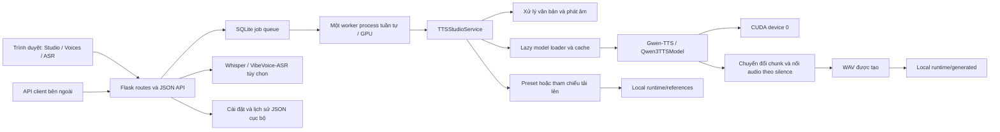
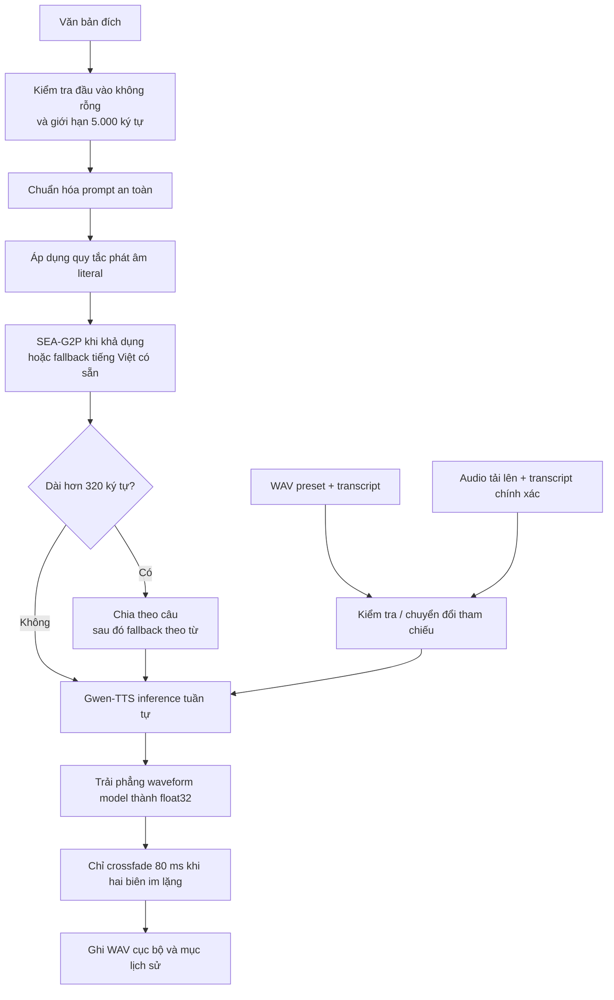

<p align="center">
  <strong>Tiếng Việt</strong> · <a href="README.en.md">English</a>
</p>

<div align="center">
  
  <h1>Vietnamese TextVoice Studio</h1>
  <p>Studio tổng hợp tiếng nói tiếng Việt xây dựng trên Gwen-TTS, hỗ trợ điều kiện hóa bằng audio tham chiếu, chuẩn hóa văn bản, sinh nội dung dài và lớp web/API Flask chạy cục bộ.</p>

  
  
  
  
  
  
</div>

> Chỉ sử dụng bản ghi tham chiếu khi có sự đồng ý của người nói và có quyền tổng hợp nội dung dự kiến.

## Tổng quan

Vietnamese TextVoice Studio phục vụ hai tác vụ liên quan:

```text
TTS tiếng Việt
Văn bản đích + preset tham chiếu có sẵn → Gwen-TTS → WAV

Tổng hợp có điều kiện tham chiếu (sao chép giọng nói)
Audio tham chiếu + transcript tham chiếu chính xác + văn bản đích → Gwen-TTS → WAV
Audio tham chiếu + văn bản đích → VieNeu v3 Turbo → WAV
```

Studio hỗ trợ chọn một engine cho từng yêu cầu: Gwen-TTS hoặc VieNeu v3 Turbo. VieNeu clone từ audio tham chiếu, không cần transcript; engine được nạp khi worker nhận job và chỉ một model TTS được giữ hoạt động tại một thời điểm. Gói VieNeu là tùy chọn: `python -m pip install -r yeu_cau_vieneu.txt`; file này ghim `huggingface-hub<1.32` để giữ các file ONNX và external data trong cùng cache layout. Notebook thử clone giọng trên Google Colab: [thu_nghiem_vieneu_clone_giong_colab.ipynb](thu_nghiem_vieneu_clone_giong_colab.ipynb).

“Sao chép giọng nói” trong repository này là điều kiện hóa tại thời điểm inference. Ứng dụng không train, fine-tune hoặc lưu một model người nói mới cho từng người dùng. Gwen-TTS dùng transcript khớp với audio tham chiếu; VieNeu nhận audio tham chiếu trực tiếp.

Project bổ sung lớp ứng dụng quanh model inference: làm sạch văn bản theo tiếng Việt, chuẩn hóa tùy chọn bằng `sea-g2p`, quy tắc phát âm, kiểm tra tham chiếu, chia đoạn khi sinh văn bản dài, ghép audio bằng crossfade, quản lý preset, job nền, lịch sử/cài đặt cục bộ và ASR tùy chọn. Studio trên trình duyệt hỗ trợ preset Gwen-TTS và audio tham chiếu tùy chỉnh cho cả Gwen-TTS lẫn VieNeu.

## Điểm kỹ thuật chính

- Chuẩn bị văn bản tiếng Việt qua hai giai đoạn, xử lý Unicode, định dạng, dấu câu, ngày, số, đơn vị và từ viết tắt.
- Thay thế cách phát âm chính xác do người dùng định nghĩa trước bước chuẩn hóa ngôn ngữ.
- Mười giọng tham chiếu có sẵn với file WAV cục bộ và transcript tương ứng.
- Gwen-TTS inference có điều kiện tham chiếu với lệnh gọi trực tiếp và các fallback tương thích.
- Chia đoạn tối đa 320 ký tự theo biên câu/dấu câu, tái sử dụng clone prompt, điều chỉnh codec budget theo chunk và chỉ crossfade tại biên im lặng.
- Tham số sinh cho main-talker và code-predictor có thể cấu hình, được giới hạn phạm vi phía server.
- Queue SQLite có backpressure, polling, lease/retry hữu hạn và một worker process tuần tự trên mỗi GPU.
- Tùy chọn chép lời tham chiếu bằng Whisper và chép lời tổng quát bằng VibeVoice-ASR.

## Kiến trúc hệ thống



### Các lớp

- **UI:** Jinja template render phía server, JavaScript thuần và CSS responsive cho Studio, Voices và trang ASR tùy chọn.
- **Application:** Flask kiểm tra multipart request, phục vụ file đã sinh, lưu cài đặt/lịch sử và cung cấp API sync/async.
- **Service:** `TTSStudioService` chịu trách nhiệm tiền xử lý, phân giải/tải model, inference, xử lý tham chiếu, ghép audio và ASR.
- **Runtime:** tham chiếu tải lên, WAV đã chuyển đổi, đầu ra đã sinh, queue SQLite, trạng thái JSON và cache Hugging Face bên ngoài.

## Pipeline TTS đầu cuối



Luồng request:

1. Flask phân giải `preset_voice_id` có sẵn hoặc `reference_audio` được tải lên.
2. `TTSStudioService.synthesize()` kiểm tra văn bản đích, sự tồn tại của tham chiếu, trạng thái CUDA/model và transcript tham chiếu bắt buộc.
3. Làm sạch định dạng chạy trước quy tắc phát âm. Chuẩn hóa từ vựng tiếng Việt chạy sau quy tắc phát âm.
4. Văn bản dài hơn 320 ký tự sau chuẩn hóa được chia và sinh tuần tự; clone prompt được tạo một lần rồi tái sử dụng khi runtime hỗ trợ.
5. Đầu ra model được trải phẳng thành waveform `float32` một chiều; crossfade 80 ms chỉ áp dụng khi cả hai biên được nhận diện là im lặng.
6. Waveform cuối được ghi dưới `webapp/runtime/generated/` và trả qua `/outputs/<filename>`.

## Xử lý văn bản tiếng Việt

Quá trình chuẩn bị văn bản gồm hai giai đoạn riêng biệt.

### 1. Chuẩn hóa prompt an toàn

`_normalize_tts_prompt_text()` thực hiện làm sạch độc lập với model:

- chuẩn hóa Unicode NFC;
- thay thế hoặc xóa non-breaking space, ký tự zero-width và ký tự BOM;
- chuyển dấu ba chấm và en/em dash có khoảng trắng thành nhịp nghỉ khi đọc;
- nối dòng và xóa ký hiệu danh sách đầu dòng như `-`, `*`, `+`, `•`, `▪`, `‣`, `◦` và `·`;
- thu gọn dấu câu lặp;
- làm sạch khoảng trắng và khoảng cách quanh dấu câu;
- thêm dấu chấm cuối cho văn bản dài chưa có dấu kết thúc.

### 2. Chuẩn hóa từ vựng tiếng Việt

Sau khi áp dụng quy tắc phát âm, `_normalize_gwen_text()` chạy một trong hai nhánh:

- **Nhánh `sea-g2p`:** nếu `sea_g2p.Normalizer(lang="vi")` tải và chạy thành công, output của nó được sử dụng sau khi xóa tag `<en>`. Integration này dùng để chuẩn hóa số, ngày, từ viết tắt, email và tiền tệ.
- **Fallback có sẵn:** nếu thiếu `sea-g2p` hoặc xảy ra lỗi, code trong repository chuyển ngày dạng số hợp lệ, số, một số từ viết tắt và đơn vị thành cách đọc.

Fallback có sẵn hiện xử lý:

- ngày dạng `DD/MM/YYYY`, `YYYY-MM-DD` và tháng/năm sau khi kiểm tra lịch hợp lệ;
- số nguyên, số có dấu, số thập phân và nhóm hàng nghìn;
- `%`, `đ`, `VNĐ`/`VND`, `USD`, `km`, `kg`, `GB` và `MB`;
- `TP.HCM`, `TP.HN`, `AI`, `KPI`, `CEO`, `CTO`, `CFO`, `COO`, `CMO`, `OK`, `ID` và `SĐT`;
- dấu ngoặc kép kiểu chữ, dấu gạch ngang, non-breaking space và khoảng cách dấu câu cuối.

Đây là bộ chuẩn hóa có phạm vi cụ thể, không phải parser ngôn ngữ tiếng Việt hoàn chỉnh. Cài `sea-g2p` để dùng nhánh chuẩn hóa rộng hơn, đồng thời dùng quy tắc phát âm cho thuật ngữ riêng của project.

## Điều khiển phát âm

Quy tắc phát âm là phép thay thế literal `from → to`, có phân biệt chữ hoa/thường. Quy tắc được sắp xếp theo độ dài nguồn và áp dụng trước `sea-g2p` hoặc fallback tiếng Việt có sẵn.

```text
KPI → cây pi ai
AI  → ây ai
```

Studio lưu quy tắc cùng văn bản đích gần nhất trong `webapp/data/user_settings.json`. Có thể import quy tắc từ file UTF-8 `.json` hoặc `.txt` và export dưới dạng JSON.

JSON chấp nhận một trong hai dạng:

```json
[
  { "from": "KPI", "to": "cây pi ai" },
  { "from": "AI", "to": "ây ai" }
]
```

```json
{
  "KPI": "cây pi ai",
  "AI": "ây ai"
}
```

TXT chấp nhận một cặp trên mỗi dòng, dùng `->`, tab, `|` hoặc `=`. Dòng trống và dòng bắt đầu bằng `#` được bỏ qua.

```text
KPI -> cây pi ai
AI|ây ai
TP.HCM = thành phố Hồ Chí Minh
```

File import bị giới hạn 512 KB. Quá trình import phân tích quy tắc trong phiên trình duyệt; dữ liệu chỉ được lưu lâu dài qua settings API.

## Điều kiện hóa giọng nói

### Giọng preset

Mỗi preset là một bản ghi JSON trong `webapp/data/gwen_preset_voices.json`, gồm ID, tên hiển thị, nhãn phong cách, tên file WAV và transcript tham chiếu chính xác. Audio nằm dưới `webapp/static/voice_presets/`. Khi chọn preset, server thay transcript do client gửi bằng transcript có sẵn tương ứng.

| ID | Tên hiển thị | Nhãn trong repository | Tham chiếu có sẵn |
| --- | --- | --- | --- |
| `yen_nhi` | Yến Nhi | Tự nhiên | [`yen_nhi.wav`](webapp/static/voice_presets/yen_nhi.wav) |
| `my_van` | Mỹ Vân | Nhẹ nhàng | [`my_van.wav`](webapp/static/voice_presets/my_van.wav) |
| `ai_vy` | Ái Vy | Truyền cảm | [`ai_vy.wav`](webapp/static/voice_presets/ai_vy.wav) |
| `an_nhi` | An Nhi | Trẻ trung | [`an_nhi.wav`](webapp/static/voice_presets/an_nhi.wav) |
| `dieu_linh` | Diệu Linh | Thanh lịch | [`dieu_linh.wav`](webapp/static/voice_presets/dieu_linh.wav) |
| `khanh_toan` | Khánh Toàn | Nam trầm | [`khanh_toan.wav`](webapp/static/voice_presets/khanh_toan.wav) |
| `tran_lam` | Trần Lâm | Nam trung | [`tran_lam.wav`](webapp/static/voice_presets/tran_lam.wav) |
| `nsnd_ha_phuong` | NSND Hà Phương | Phát thanh viên | [`nsnd_ha_phuong.wav`](webapp/static/voice_presets/nsnd_ha_phuong.wav) |
| `nsnd_kim_cuc` | NSND Kim Cúc | Kể chuyện | [`nsnd_kim_cuc.wav`](webapp/static/voice_presets/nsnd_kim_cuc.wav) |
| `kha_han` | Khả Hân | Trong trẻo | [`kha_han.wav`](webapp/static/voice_presets/kha_han.wav) |

Các nhãn này lấy từ metadata trong repository; chúng không phải thuộc tính người nói hoặc đánh giá chất lượng đã được đo lường.

### Tham chiếu tùy chỉnh

Tổng hợp tùy chỉnh cần đủ ba đầu vào:

```text
reference_audio + exact reference_text + target text
```

TTS chấp nhận upload `.wav`, `.mp3`, `.m4a`, `.flac` và `.ogg`. Flask áp dụng giới hạn toàn cục 32 MB cho request. Nhánh Gwen sau đó yêu cầu:

- thời lượng từ 2 đến 18 giây;
- waveform không im lặng;
- tối thiểu 8% hoạt động được phát hiện bằng amplitude envelope 30 ms;
- transcript không rỗng và caller phải đảm bảo khớp với nội dung được nói trong tham chiếu.

Ứng dụng khuyến nghị 3–10 giây, một người nói rõ và ít tạp âm. Đây là hướng dẫn, không phải cam kết chất lượng.

### Xử lý audio tham chiếu

Cách xử lý tham chiếu phụ thuộc định dạng nguồn:

- Mọi file đều được decode để kiểm tra. Dữ liệu nhiều kênh được lấy trung bình thành mono trong mảng kiểm tra thời lượng, peak và mức hoạt động.
- File `.wav` hợp lệ được truyền cho Gwen-TTS bằng đường dẫn gốc sau khi kiểm tra; ứng dụng không ghi lại hoặc resample file này.
- File không phải WAV được decode, downmix, resample về 24 kHz, cân bằng DC, peak-normalize về `0.92`, clip trong `[-1, 1]` và ghi thành WAV staging PCM 16-bit mono.
- File gần như im lặng bị từ chối. Nhánh Gwen kiểm tra mật độ im lặng nhưng không cắt khoảng lặng khỏi tham chiếu.
- File upload và WAV staging đã chuyển đổi được giữ dưới `webapp/runtime/references/`; chưa có chính sách tự động xóa file.

## Tích hợp Gwen-TTS

Model mặc định:

```text
g-group-ai-lab/gwen-tts-0.6B
```

Service import `qwen_tts.Qwen3TTSModel` và tải model được chọn qua:

```text
Qwen3TTSModel.from_pretrained(
    model_id,
    device_map="cuda:0",
    dtype=...,
    attn_implementation=...
)
```

Model được tải lazy khi bắt đầu lần tổng hợp đầu tiên. Instance được cache trong process theo model ID, dtype và attention backend được yêu cầu. Một lock tuần tự hóa quá trình tải model. Hugging Face quản lý tải xuống/cache model; thư mục `models/` do repository tạo hiện được để dành và không truyền làm `cache_dir`.

Attention backend mặc định là `flash_attention_2`. Nếu tải thất bại với đúng lựa chọn này, service thử lại bằng `sdpa`. Vì vậy FlashAttention là tùy chọn; SDPA là fallback tương thích có sẵn.

Service gọi trực tiếp `generate_voice_clone` theo flow của Gwen trước; chỉ tạo và cache `voice_clone_prompt` nếu runtime không hỗ trợ `ref_audio`/`ref_text`. Thứ tự tương thích:

1. gọi `generate_voice_clone(text, ref_audio, ref_text, ...)`, để Gwen tự nhận diện tiếng Việt như script inference upstream;
2. truyền `language="Vietnamese"` nếu runtime yêu cầu;
3. dùng `voice_clone_prompt` nếu runtime không hỗ trợ trực tiếp `ref_audio`/`ref_text`.

Nếu runtime `qwen-tts` đã cài không chấp nhận `speed`, service thử lại không có tham số đó và ghi fallback vào `notes` của response.

API hỗ trợ model ID tùy chỉnh qua `model_key=__custom__` cùng `custom_model`. Giá trị được truyền đến `from_pretrained()` và phải tương thích với runtime `qwen-tts` đã cài.

## Tổng hợp nội dung dài và ghép audio

Giới hạn request là 5.000 ký tự. Sau mọi bước biến đổi văn bản:

- văn bản tối đa 320 ký tự được sinh bằng một lần gọi;
- văn bản dài hơn ưu tiên biên câu kể cả dấu ngoặc kép/ngoặc đóng, sau đó lần lượt dùng `;`, `:`, dấu phẩy và khoảng trắng;
- hard split tránh đặt combining mark, variation selector hoặc ZWJ ở đầu chunk khi có thể và cân bằng tail quá ngắn;
- các chunk được tổng hợp tuần tự bằng cùng model instance và dùng lại `voice_clone_prompt` khi runtime hỗ trợ;
- `max_new_tokens` là trần codec token; service dùng giá trị nhỏ hơn giữa trần cấu hình và ngân sách thích nghi `max(512, 4 × số ký tự chunk)`;
- mọi waveform trả về được chuyển thành mảng `float32` đã trải phẳng;
- các waveform liền kề chỉ được linear crossfade 80 ms khi RMS ở cả hai biên thấp cả theo ngưỡng tuyệt đối và tương đối; nếu không chúng được nối trực tiếp;
- waveform tổng hợp được ghi thành một WAV ở sample rate do model trả về, hoặc 24 kHz nếu không có sample rate.

Chia chunk giảm kích thước văn bản mỗi lần gọi và giúp xử lý request dài dễ hơn. Repository chưa có số đo về thời lượng tối đa, mục tiêu độ trễ, real-time factor hoặc memory profile.

## Tham số sinh

Giá trị được giới hạn phía server trước inference.

| Form field | Tham số model | Mặc định | Phạm vi | Mục đích |
| --- | --- | ---: | --- | --- |
| `speed` | `speed` | `1.0` | `0.7–1.3` | Hệ số tốc độ nói yêu cầu; có thể bị bỏ với runtime không tương thích |
| `gwen_temperature` | `temperature` | `0.3` | `0.1–1.0` | Sampling temperature của bước sinh chính |
| `gwen_top_p` | `top_p` | `0.9` | `0.1–1.0` | Ngưỡng nucleus sampling chính |
| `gwen_top_k` | `top_k` | `20` | `1–100` | Giới hạn top-k chính |
| `gwen_repetition_penalty` | `repetition_penalty` | `2.0` | `1.0–3.0` | Mức phạt lặp |
| `gwen_max_new_tokens` | `max_new_tokens` | `4096` | `512–8192` | Trần codec token mỗi lần gọi; budget thực tế tự giảm theo độ dài chunk |
| `gwen_subtalker_do_sample` | `subtalker_do_sample` | `true` | boolean | Bật sampling cho code-predictor |
| `gwen_subtalker_temperature` | `subtalker_temperature` | `0.1` | `0.1–1.0` | Temperature của code-predictor |
| `gwen_subtalker_top_k` | `subtalker_top_k` | `20` | `1–100` | Top-k của code-predictor |
| `gwen_subtalker_top_p` | `subtalker_top_p` | `1.0` | `0.1–1.0` | Top-p của code-predictor |

UI hiển thị `gumbel` là phương thức sampling cố định của code-predictor nhưng không truyền giá trị này trong model kwargs. `seed` và `remove_silence` được lớp Flask request phân tích nhưng nhánh tổng hợp Gwen hiện không sử dụng.

## ASR tùy chọn

ASR hỗ trợ quy trình TTS nhưng không bắt buộc cho tổng hợp. Tính năng bị tắt mặc định qua `TTS_ENABLE_ASR=0`.

### Chép lời tham chiếu bằng Whisper

`POST /api/tts/transcribe-reference` mặc định dùng `openai/whisper-small` để tạo bản nháp transcript cho tham chiếu tùy chỉnh. Quy trình:

1. decode và downmix audio;
2. resample về 16 kHz;
3. cân bằng DC và peak-normalize;
4. cắt khoảng lặng đầu/cuối được phát hiện, giữ padding 80 ms;
5. từ chối audio ngắn hơn 0,35 giây sau khi cắt;
6. chạy Transformers ASR pipeline với `task="transcribe"` và ngôn ngữ mặc định `vi`.

Whisper dùng FP16 trên CUDA và FP32 trên CPU.

### Chép lời tổng quát bằng VibeVoice-ASR

`POST /api/asr/transcribe` và `/asr` mặc định dùng `microsoft/VibeVoice-ASR-HF`. Trang hỗ trợ:

- upload `.wav`, `.mp3`, `.m4a`, `.flac`, `.ogg` và `.webm`;
- hotword/context tùy chọn;
- `max_new_tokens` từ 2.048 đến 16.384;
- tokenizer chunk từ 5 đến 60 giây;
- `bfloat16`, `float16` hoặc `float32`;
- form field `system_prompt` được service hiện tại chấp nhận nhưng không truyền đến processor/model;
- văn bản thuần hoặc segment người nói/timestamp đã phân tích khi processor trả về.

Backend áp dụng giới hạn request 32 MB và thời lượng tối thiểu 0,5 giây, nhưng không áp dụng giới hạn “60 phút” đang hiển thị trong nội dung trang ASR.

### Ranh giới dependency

Profile TTS Colab/Kaggle trong repository pin `qwen-tts==0.1.1` cùng `transformers==4.57.3`. Nhánh VibeVoice báo yêu cầu `transformers>=5.3.0`. Do các yêu cầu xung đột, notebook chủ động chỉ chạy TTS và tắt ASR. Dùng environment/process riêng cho VibeVoice-ASR khi dependency resolver không thể thỏa mãn cả hai stack.

## Web Studio

| Trang | Hành vi hiện tại |
| --- | --- |
| `/studio/gwen` | Chọn preset, nhập văn bản đích, chỉnh tham số sinh, quy tắc phát âm, tổng hợp async, phát/tải xuống và tìm lịch sử cục bộ |
| `/voices` | Tìm, nghe thử, tải xuống và chọn mười preset; thu thập audio/transcript tùy chỉnh và tùy chọn gọi Whisper |
| `/asr` | UI chép lời VibeVoice-ASR; route chỉ hiển thị khi ASR được bật |

Ranh giới UI hiện tại: `/studio/gwen` luôn submit giọng preset. Panel tham chiếu tùy chỉnh trên `/voices` không chuyển đối tượng `File` của trình duyệt sang Studio. Dùng `POST /api/tts/generate` để tổng hợp bằng tham chiếu tùy chỉnh cho đến khi luồng trình duyệt này được kết nối.

Cài đặt và lịch sử nằm cục bộ trên server, không phải cục bộ trên trình duyệt:

- thay đổi văn bản và phát âm được debounce đến `/api/settings/save`;
- văn bản và quy tắc gần nhất được tải từ `/api/settings/load`;
- kết quả tổng hợp sync hoặc async thành công được thêm vào lịch sử JSON tối đa 50 mục;
- Studio hiển thị thời lượng output, thời gian inference, sample rate, số chunk, model, giọng, điều khiển phát và tải xuống.

## Tổng hợp đồng bộ và bất đồng bộ

`POST /api/tts/generate` hỗ trợ cả hai chế độ.

```text
Đồng bộ
request → enqueue SQLite → chờ worker GPU → kết quả 200 hoặc 202 khi hết timeout

Bất đồng bộ
request → enqueue SQLite → 202 + job_id
        → một worker process/GPU → poll trạng thái → kết quả
```

- Đặt `async=1` để buộc chạy nền.
- Đặt `async=0` để buộc chạy đồng bộ.
- Nếu bỏ qua, request có `CF-Connecting-IP` hoặc `CF-Ray` mặc định chạy async; request khác mặc định chạy sync.
- Studio hiện luôn gửi `async=1` và poll mỗi 1,5 giây.
- Queue giới hạn 32 job chưa terminal. Claim FIFO dùng transaction SQLite; mỗi job chạy có lease, heartbeat và tối đa hai lần claim khi worker chết.
- Metadata job bị xóa một giờ sau lần cập nhật cuối. WAV đã sinh không bị xóa cùng metadata job.

## API

### Trạng thái engine

```http
GET /api/tts/status
```

Trả về trạng thái sẵn sàng của engine, metadata model, tóm tắt CUDA/CPU và trạng thái bật ASR.

### Tổng hợp bằng preset

```bash
curl -X POST http://127.0.0.1:8386/api/tts/generate \
  -F 'text=Xin chào, đây là bản ghi thử.' \
  -F 'preset_voice_id=yen_nhi' \
  -F 'async=0'
```

### Tổng hợp có điều kiện tham chiếu tùy chỉnh

```bash
curl -X POST http://127.0.0.1:8386/api/tts/generate \
  -F 'text=Xin chào, đây là nội dung mới.' \
  -F 'reference_audio=@sample.wav' \
  -F 'reference_text=Xin chào, đây là câu nói chính xác trong audio mẫu.' \
  -F 'async=0'
```

Response đồng bộ thành công gồm các field ổn định như:

```json
{
  "ok": true,
  "engine": "gwen",
  "model_label": "g-group-ai-lab/gwen-tts-0.6B",
  "audio_url": "/outputs/<generated-file>.wav",
  "download_name": "<generated-file>.wav",
  "reference_text_used": true,
  "notes": []
}
```

Payload đầy đủ còn báo các giá trị số `sample_rate`, `duration_seconds`, `inference_seconds` và `chunk_count` đo được cho request đó.

### Polling job async

```bash
JOB_ID="$(
  curl -sS -X POST http://127.0.0.1:8386/api/tts/generate \
    -F 'text=Xin chào từ hàng đợi.' \
    -F 'preset_voice_id=yen_nhi' \
    -F 'async=1' |
  python -c 'import json, sys; print(json.load(sys.stdin)["job_id"])'
)"

curl -sS "http://127.0.0.1:8386/api/tts/jobs/${JOB_ID}"
```

Job response dùng `queued`, `running`, `completed` hoặc `failed`. Response hoàn tất đặt payload tổng hợp dưới `result`; trạng thái chờ/chạy có thể kèm `queue_position`, `gpu_index` và `attempts`. Khi 32 job chưa terminal đã chiếm queue, API trả `429` cùng `Retry-After`.

### Endpoint hỗ trợ

| Method | Route | Mục đích |
| --- | --- | --- |
| `GET` | `/outputs/<filename>` | Phục vụ trực tiếp file audio đã sinh |
| `GET` | `/api/history` | Trả về tối đa 50 mục lịch sử đã lưu |
| `GET` | `/api/settings/load` | Tải quy tắc phát âm và văn bản gần nhất |
| `POST` | `/api/settings/save` | Lưu quy tắc phát âm và văn bản gần nhất |
| `POST` | `/api/pronunciation/upload` | Phân tích quy tắc phát âm `.json` hoặc `.txt` |
| `POST` | `/api/pronunciation/export` | Tải quy tắc xuống dạng JSON |
| `POST` | `/api/tts/transcribe-reference` | Chép lời tham chiếu bằng Whisper tùy chọn |
| `POST` | `/api/asr/transcribe` | Chép lời bằng VibeVoice-ASR tùy chọn |

## Yêu cầu

### Phần mềm

- Python 3. Chưa khai báo minor version tối thiểu; notebook hosted trong repository dùng metadata Python 3.12. Repository chưa kiểm tra khả năng tương thích ngoài profile này.
- Linux là runtime được mô tả trong notebook.
- Thiết lập notebook hosted cài `ffmpeg`, `libsndfile1` và `espeak-ng`.
- Package nền từ `requirements.txt`: Flask, librosa, NumPy và SoundFile.
- Bản PyTorch tương thích CUDA cùng runtime `qwen-tts` để tổng hợp.
- Kết nối Internet ở lần dùng model đầu nếu file model chưa có trong Hugging Face cache.

### Phần cứng

- Gwen loader cục bộ hiện yêu cầu `torch.cuda.is_available()` và gắn model vào `cuda:0`. TTS chỉ dùng CPU bị từ chối.
- Dtype có thể cấu hình gồm `bfloat16`, `float16` và `float32`; mặc định là `bfloat16`.
- FlashAttention không bắt buộc vì loader có thể thử lại bằng SDPA.
- Whisper và VibeVoice ASR có thể chọn CPU khi không có CUDA, nhưng hiệu năng CPU chưa được benchmark.
- Repository chưa có yêu cầu VRAM, mục tiêu độ trễ hoặc ma trận GPU hỗ trợ có thể tái lập.

## Cài đặt

### 1. Clone và tạo environment

```bash
git clone https://github.com/sin0235/vietnamese-tts-studio.git
cd vietnamese-tts-studio
python -m venv .venv
source .venv/bin/activate
python -m pip install --upgrade pip setuptools wheel
```

### 2. Cài công cụ audio hệ thống trên Debian/Ubuntu

```bash
sudo apt-get update
sudo apt-get install -y ffmpeg libsndfile1 espeak-ng
```

Dùng package tương đương trên hệ điều hành khác.

### 3. Cài dependency nền của ứng dụng

```bash
python -m pip install -r requirements.txt
```

### 4. Cài bản PyTorch hỗ trợ CUDA

Chọn bản phù hợp với NVIDIA driver đã cài theo [hướng dẫn cài PyTorch](https://pytorch.org/get-started/locally/). Profile Colab/Kaggle trong repository hiện dùng:

```bash
python -m pip install torch==2.11.0 torchaudio==2.11.0 \
  --index-url https://download.pytorch.org/whl/cu128
```

Profile này là bằng chứng từ repository, không phải khuyến nghị CUDA áp dụng cho mọi hệ thống.

### 5. Cài runtime chỉ dành cho TTS

Notebook hosted định nghĩa tập dependency sau:

```bash
python -m pip install \
  transformers==4.57.3 \
  accelerate==1.12.0 \
  sentencepiece \
  sox \
  onnxruntime \
  einops \
  sea-g2p
python -m pip install qwen-tts==0.1.1 --no-deps
```

`requirements.txt` chủ động chỉ chứa dependency web/audio. Dependency PyTorch và Gwen được tách riêng vì phiên bản phụ thuộc profile CUDA/runtime. Repository chưa có một lock file duy nhất cho mọi environment cục bộ.

### 6. Kiểm tra CUDA và import

```bash
python -c "import torch; print(torch.__version__, torch.cuda.is_available(), torch.cuda.get_device_name(0) if torch.cuda.is_available() else None)"
python -c "import qwen_tts, sea_g2p; print('Gwen-TTS runtime ready')"
```

`torch.cuda.is_available()` phải in `True` để chạy TTS.

### 7. Khởi động ứng dụng

```bash
TTS_GPU_IDS=0 python -m webapp.serve --host 0.0.0.0 --port 8386
```

Mở `http://127.0.0.1:8386/studio/gwen`.

### Environment ASR tùy chọn

Để chép lời tham chiếu bằng Whisper, bật ASR sau khi cài Transformers stack:

```bash
python -m pip install -U transformers accelerate sentencepiece
TTS_ENABLE_ASR=1 TTS_GPU_IDS=0 python -m webapp.serve --host 0.0.0.0 --port 8386
```

VibeVoice-ASR có thể yêu cầu `transformers>=5.3.0`, xung đột với profile `qwen-tts==0.1.1` trong repository. Nên dùng environment ASR riêng thay vì thay thế dependency TTS đang hoạt động tại chỗ.

## Sử dụng

### Web Studio

1. Mở `/studio/gwen`.
2. Chọn một trong mười giọng preset và nghe thử tham chiếu nếu cần.
3. Nhập tối đa 5.000 ký tự tiếng Việt.
4. Điều chỉnh tham số sinh hoặc quy tắc phát âm khi cần.
5. Chọn **Chuyển Đổi**. UI đưa một job cục bộ vào hàng đợi và poll đến khi hoàn tất.
6. Phát, tua, tải xuống hoặc sao chép URL WAV đã sinh; các lần chạy thành công trước đó xuất hiện trong lịch sử.

### Tham chiếu tùy chỉnh qua API

Dùng ví dụ `curl` tùy chỉnh ở trên với tham chiếu dài 2–18 giây và transcript chính xác. Nếu ASR được bật, `/voices` có thể tạo bản nháp transcript bằng Whisper; cần kiểm tra thủ công trước khi tổng hợp.

### Notebook Colab và Kaggle

- `colab_tts_cloudflare.ipynb` đặt `TTS_GPU_IDS=0`, chạy supervisor Flask/worker, mở Cloudflare Quick Tunnel và có thể đồng bộ thư mục generated/reference/data lên Google Drive.
- `kaggle_tts_cloudflare.ipynb` dùng `TTS_GPU_IDS=0,1` khi runtime thấy ít nhất hai GPU, nếu không fallback `0`; quy trình backup nằm dưới `/kaggle/working/tts_backup/`.

Cả hai notebook hiện hard-code URL cũ `https://github.com/sin0235/text2speech.git`. Đổi `REPO_URL` thành `https://github.com/sin0235/vietnamese-tts-studio.git` trước khi chạy từ phiên mới.

## Cấu hình

### Web server

| Biến | Mặc định | Mô tả |
| --- | --- | --- |
| `TTS_WEBAPP_HOST` | `0.0.0.0` | Host Flask bind |
| `TTS_WEBAPP_PORT` | `8386` | Cổng Flask; giá trị không hợp lệ fallback về `8386` |
| `TTS_WEBAPP_DEBUG` | `0` | Bật Flask debug với `1`, `true`, `yes` hoặc `on` |
| `TTS_WEBAPP_RELOADER` | `0` | Bật Flask reloader với cùng các giá trị truthy |
| `TTS_GPU_IDS` | `0` | Danh sách GPU vật lý, ví dụ `0,1`; supervisor tạo đúng một worker tuần tự trên mỗi GPU |
| `TTS_QUEUE_MAX_PENDING` | `32` | Số job `queued` hoặc `running` tối đa |
| `TTS_JOB_LEASE_SECONDS` | `30` | Lease của job đang chạy; worker heartbeat gia hạn định kỳ |
| `TTS_JOB_MAX_ATTEMPTS` | `2` | Số lần claim tối đa trước khi job hết lease chuyển `failed` |
| `TTS_SYNC_WAIT_SECONDS` | `120` | Thời gian `async=0` chờ; hết hạn trả `202` để client tiếp tục poll |

### Gwen-TTS

| Biến | Mặc định | Mô tả |
| --- | --- | --- |
| `GWEN_MODEL_ID` | `g-group-ai-lab/gwen-tts-0.6B` | Model ID mặc định cho `from_pretrained()` |
| `GWEN_MODEL_CHOICES` | rỗng | Các lựa chọn `Label=model-id` phân cách bằng dấu chấm phẩy/dòng mới trong service metadata; Studio hiện không render model selector |
| `GWEN_DTYPE` | `bfloat16` | `bfloat16`, `float16` hoặc `float32` |
| `GWEN_ATTN_IMPLEMENTATION` | `flash_attention_2` | Attention backend được yêu cầu; lựa chọn FlashAttention chính xác có thể fallback về `sdpa` |

```bash
GWEN_DTYPE=float16 \
GWEN_ATTN_IMPLEMENTATION=sdpa \
TTS_GPU_IDS=0 \
python -m webapp.serve --host 127.0.0.1 --port 8386
```

### ASR

| Biến | Mặc định | Mô tả |
| --- | --- | --- |
| `TTS_ENABLE_ASR` | `0` | Bật route/UI Whisper và VibeVoice-ASR |
| `ASR_MODEL_ID` | `openai/whisper-small` | Model chép lời tham chiếu |
| `ASR_LANGUAGE` | `vi` | Ngôn ngữ sinh Whisper |
| `ASR_CHUNK_LENGTH_S` | `18` | Kích thước chunk Whisper, giới hạn 8–30 giây |
| `VIBEVOICE_ASR_MODEL_ID` | `microsoft/VibeVoice-ASR-HF` | Model chép lời tổng quát |

## Dữ liệu runtime và quyền riêng tư

`TTSStudioService` tạo các thư mục sau khi ứng dụng được import:

```text
webapp/runtime/references/   Bản ghi tham chiếu đã tải lên và chuyển đổi
webapp/runtime/generated/    File WAV đã sinh
webapp/runtime/tts_jobs.sqlite3  Trạng thái queue SQLite cục bộ
models/                      Thư mục cục bộ để dành; không phải Hugging Face cache đã cấu hình
```

Các file sau được tạo khi cần:

```text
webapp/data/user_settings.json   Văn bản và quy tắc phát âm gần nhất
webapp/data/tts_history.json     Tối đa 50 bản ghi tổng hợp thành công
```

Model weight dùng Hugging Face cache mặc định trừ khi cấu hình environment bên ngoài thay đổi. Trạng thái queue nằm trong SQLite và còn sau khi Flask khởi động lại; lease hết hạn được retry hữu hạn. Không sao lưu file queue đang hoạt động lên Drive.

Bản ghi tham chiếu, transcript, văn bản đích và tiếng nói được sinh có thể là dữ liệu nhạy cảm. Code hiện tại không có authentication, tenant isolation, lớp mã hóa, tự động dọn dẹp hoặc chính sách access control. Không mở Flask server hoặc Cloudflare tunnel trong notebook cho người dùng không tin cậy. `.gitignore` loại trừ runtime queue/audio và JSON trạng thái cục bộ; vẫn cần kiểm soát backup bên ngoài repository.

## Cấu trúc project

```text
vietnamese-tts-studio/
├── webapp/
│   ├── app.py                         # Flask routes, persistence và job trong process
│   ├── tts_service.py                 # Xử lý text/audio, Gwen-TTS và ASR
│   ├── data/
│   │   └── gwen_preset_voices.json   # Metadata preset và transcript tham chiếu
│   ├── static/
│   │   ├── css/style.css             # Giao diện responsive Studio/Voices/ASR
│   │   ├── images/                   # Asset nhận diện project
│   │   └── voice_presets/            # Mười WAV tham chiếu có sẵn
│   ├── templates/
│   │   ├── studio_engine.html        # TTS Studio dùng preset hiện tại
│   │   ├── voices.html               # Trình duyệt preset và trợ giúp tham chiếu tùy chỉnh
│   │   └── asr.html                  # Trang VibeVoice-ASR tùy chọn
│   └── runtime/                       # Tạo cục bộ; tham chiếu và WAV đã sinh
├── tests/                             # unittest API/helper với inference mock
├── colab_tts_cloudflare.ipynb         # Cài đặt Colab, runtime, tunnel và backup
├── kaggle_tts_cloudflare.ipynb        # Cài đặt Kaggle, runtime, tunnel và backup
├── requirements.txt                   # Dependency Flask/audio nền
├── README.en.md                       # Tài liệu tiếng Anh
└── README.md                          # Tài liệu tiếng Việt mặc định
```

`home.html`, `about.html` và `scraper.html` vẫn tồn tại dưới `webapp/templates/`, nhưng Flask route hiện tại không render chúng.

## Kiểm thử

Chạy test suite của repository sau khi cài dependency nền:

```bash
python -m unittest discover -s tests -v
```

Test bao phủ:

- Flask routing, lỗi JSON, giới hạn upload, ASR gating, submit preset và trạng thái job async;
- làm sạch văn bản, fallback cho số/ngày/từ viết tắt tiếng Việt, quy tắc phát âm và giới hạn tham số;
- phân giải metadata preset, chuẩn hóa/kiểm tra tham chiếu, fallback ngôn ngữ, biên chunk, prompt cache, codec budget thích nghi và nối audio theo silence;
- thông báo lỗi attention/import và kiểm tra trạng thái CUDA.

Gwen và ASR inference được mock. Test không tải model weight, chạy tổng hợp CUDA thật, đánh giá chất lượng âm thanh hoặc chạy VibeVoice-ASR đầy đủ.

## Trạng thái demo và đánh giá

Repository có mười WAV preset có thể nghe và trình phát output hoạt động trên trình duyệt. Các asset này minh họa việc chọn tham chiếu và hành vi ứng dụng đầu cuối; chúng không phải đánh giá chất lượng tiếng nói chính thức.

Hiện chưa có benchmark MOS, độ tương đồng người nói, CER/WER, độ dễ hiểu, độ tự nhiên, độ trễ, real-time factor hoặc VRAM có thể tái lập. Project tập trung vào tổng hợp và tích hợp ở tầng ứng dụng thay vì đánh giá TTS định lượng.

## Hạn chế

- Mỗi worker Gwen-TTS chỉ thấy một GPU vật lý và dùng `cuda:0` bên trong process; không hỗ trợ TTS chỉ dùng CPU.
- Quá trình tổng hợp không streaming. Client nhận WAV hoàn chỉnh sau khi mọi chunk hoàn tất.
- Queue SQLite có backpressure, lease và retry hữu hạn nhưng chưa có API hủy job đang chạy hoặc ưu tiên job.
- Studio trên trình duyệt hiện chỉ cung cấp preset; tổng hợp bằng tham chiếu tùy chỉnh cần gọi API trực tiếp.
- VibeVoice-ASR và profile TTS notebook đã pin yêu cầu các phiên bản Transformers không tương thích.
- Audio tham chiếu và audio đã sinh được giữ vô thời hạn nếu không xóa thủ công.
- Flask route không có authentication, rate limiting, API key hoặc biện pháp chống mạo danh.
- Độ tương đồng giọng và phát âm phụ thuộc chất lượng tham chiếu cùng độ chính xác transcript; chưa có benchmark chính thức.
- Dependency cục bộ chưa được lock đầy đủ ngoài profile notebook hosted.

## Hướng phát triển

- Kết nối lựa chọn tham chiếu tùy chỉnh trực tiếp vào luồng submit của Studio.
- Tách runtime hoặc service TTS và ASR để loại bỏ xung đột dependency Transformers.
- Thêm streaming hoặc tổng hợp nội dung dài dạng lũy tiến và hủy job rõ ràng.
- Chuyển job sang worker backend durable và thêm cơ chế lưu giữ/xóa audio cùng trạng thái.
- Thêm deployment profile có authentication, API authorization và biện pháp chống lạm dụng.
- Công bố đánh giá MOS, độ tương đồng người nói, độ dễ hiểu, độ trễ và bộ nhớ có thể tái lập.
- Thêm profile container/runtime đã kiểm tra và từ điển phát âm tiếng Việt rộng hơn.

## Sử dụng có trách nhiệm

Chỉ sử dụng giọng và bản ghi khi có quyền hoặc sự đồng ý rõ ràng. Không dùng audio được sinh để mạo danh, lừa đảo, quấy rối hoặc xuyên tạc người khác. Kiểm tra transcript và output trước khi công bố, đặc biệt khi dùng ASR để tạo bản nháp văn bản tham chiếu.

## Giấy phép

Repository hiện chưa có file giấy phép. Cho đến khi chủ sở hữu bổ sung, không nên giả định source và asset giọng nói có sẵn cho phép tái sử dụng, phân phối lại hoặc sử dụng thương mại.
